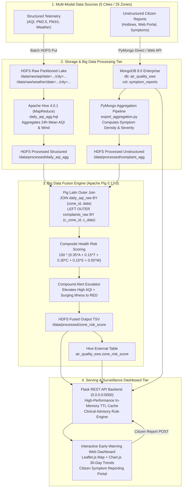
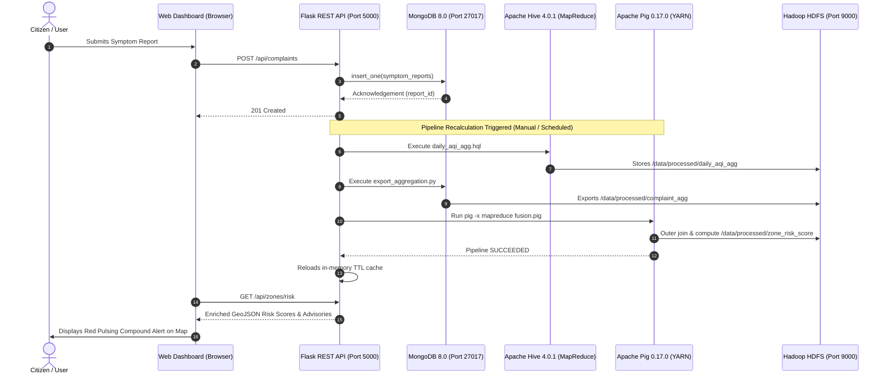

# Multi-City Air Quality & Public Health Early-Warning System: Architecture & Data Flow

**Course:** 21MDS56 – Big Data Computing Laboratory  
**Institution:** Coimbatore Institute of Technology (CIT), Coimbatore  
**Author:** Mithra (M.Sc Data Science)  

---

## 1. System Architecture Overview

The system architecture is organized into four distinct operational tiers:
1. **Multi-Modal Data Ingestion Tier:** Hourly physical sensor feeds and asynchronous citizen symptom streams.
2. **Distributed Storage & Processing Tier (Hadoop / Hive / MongoDB):** HDFS distributed filesystem, Hive partitioning, and MongoDB document indexing.
3. **Big Data Fusion Engine (Apache Pig):** MapReduce relational joining, normalization, composite health risk scoring, and tier escalation.
4. **Surveillance & Early-Warning Delivery Tier:** High-performance Flask REST API service with TTL caching and an interactive Leaflet/Chart.js web dashboard.



---

## 2. Relational Schemas & Storage Design

### 2.1 HDFS Raw Partitioning Scheme
To optimize partition pruning during daily analytical scans, structured telemetry is partitioned symmetrically by `date` and `city`:
```
/data/raw/aqi/date=YYYY-MM-DD/city=<CityName>/aqi.json
/data/raw/weather/date=YYYY-MM-DD/city=<CityName>/weather.json
```
- Total Partitions per Dataset: 31 days $\times$ 5 cities = **155 partitions**.
- Record Volume: 18,000 hourly AQI records + 18,000 hourly weather records.

### 2.2 Apache Hive Data Definition
Hive external tables manage structured datasets directly on top of HDFS:

```sql
CREATE EXTERNAL TABLE aqi_readings (
    record_id STRING,
    zone_id STRING,
    zone_name STRING,
    ts STRING,
    aqi INT,
    pm25 DOUBLE,
    pm10 DOUBLE,
    no2 DOUBLE,
    so2 DOUBLE,
    co DOUBLE
)
PARTITIONED BY (`date` STRING, city STRING)
ROW FORMAT SERDE 'org.apache.hadoop.hive.serde2.JsonSerDe'
LOCATION '/data/raw/aqi';
```

### 2.3 MongoDB Document Structure
Citizen complaints are represented as rich JSON documents in MongoDB `symptom_reports`:

```json
{
  "_id": "6ace3a72353f02c466dbdf02",
  "report_id": "RPT-WEB-1791900252",
  "city": "Coimbatore",
  "zone_id": "CBE_ZN_01",
  "zone_name": "SIDCO Industrial Estate",
  "date": "2026-10-13",
  "date_str": "2026-10-13",
  "reported_at": "2026-10-13 14:04:12",
  "symptoms": ["cough", "shortness_of_breath"],
  "severity": "severe",
  "age_group": "adult",
  "channel": "citizen_web_portal",
  "description": "Thick acrid fumes near factory gates"
}
```

---

## 3. End-to-End Orchestration Sequence


